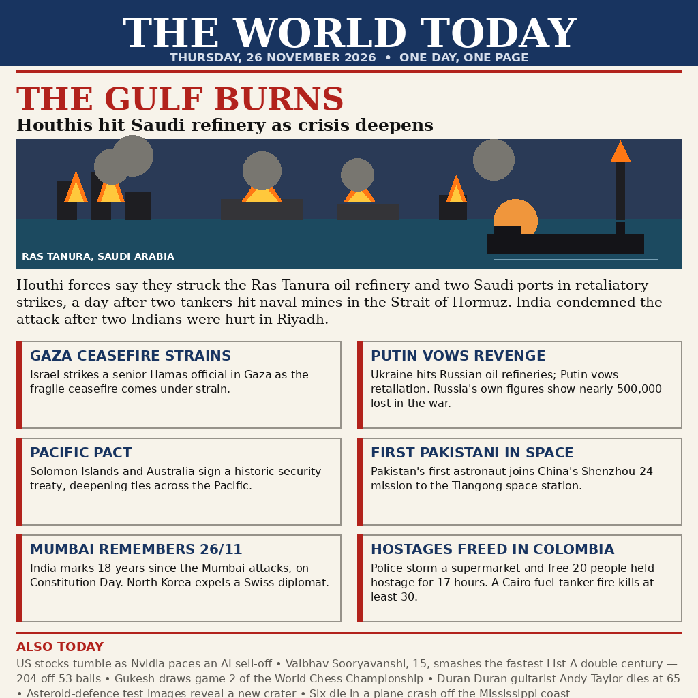

# The Gulf Burns — The World Today, Thursday 26 November 2026

Play make.fun bounties with me: https://make.fun/r/v4m1pbv2

A newspaper front page summing up Thursday 26 November 2026's world news
in one image: the Gulf escalation leads, with the day's other big stories
from Gaza, Ukraine, the Pacific, space, India and sport.

## The day's news

- **Lead — The Gulf Burns.** Houthi forces say they struck the Ras Tanura
  oil refinery and two Saudi ports in retaliatory strikes, a day after two
  tankers hit naval mines in the Strait of Hormuz. India condemned the
  attack after two Indians were hurt in Riyadh.
- **Israel strikes a senior Hamas official in Gaza** as the fragile
  ceasefire comes under strain.
- **Ukraine hits Russian oil refineries; Putin vows retaliation.** Russia's
  own figures show nearly 500,000 lost in the war.
- **Solomon Islands and Australia sign a historic security treaty.**
- **Pakistan's first astronaut joins China's Shenzhou-24 mission** to the
  Tiangong space station.
- **India marks 18 years since the 26/11 Mumbai attacks,** on Constitution
  Day; North Korea expels a Swiss diplomat.
- **Colombia police free 20 hostages** held 17 hours in a supermarket;
  a Cairo fuel-tanker fire kills at least 30.
- Also today: US stocks tumble as Nvidia paces an AI sell-off; Vaibhav
  Sooryavanshi, 15, smashes the fastest List A double century (204 off
  53 balls); Gukesh draws game 2 of the World Chess Championship;
  Duran Duran guitarist Andy Taylor dies at 65; asteroid-defence test
  images reveal a new crater; six die in a plane crash off the
  Mississippi coast.

## How it works

`gen_image.py` draws the front page (1024×1024 PNG) with Pillow at build
time — masthead, headline, a hand-drawn dusk scene over the Ras Tanura
refinery, six story cards and a footer ticker of briefs. Re-running
`gen_image.py` reproduces the identical PNG. `main.ts` (Node 22, standard
library only, no network) validates the PNG — signature, 1024×1024 header,
every chunk CRC, complete IEND, at most 1 MiB — then copies `entry.png` to
`$MAKEFUN_OUTPUT_DIR/entry.png` (default `/output`) and verifies the copy
hashes exactly like the source. Running it twice produces byte-identical
output.
